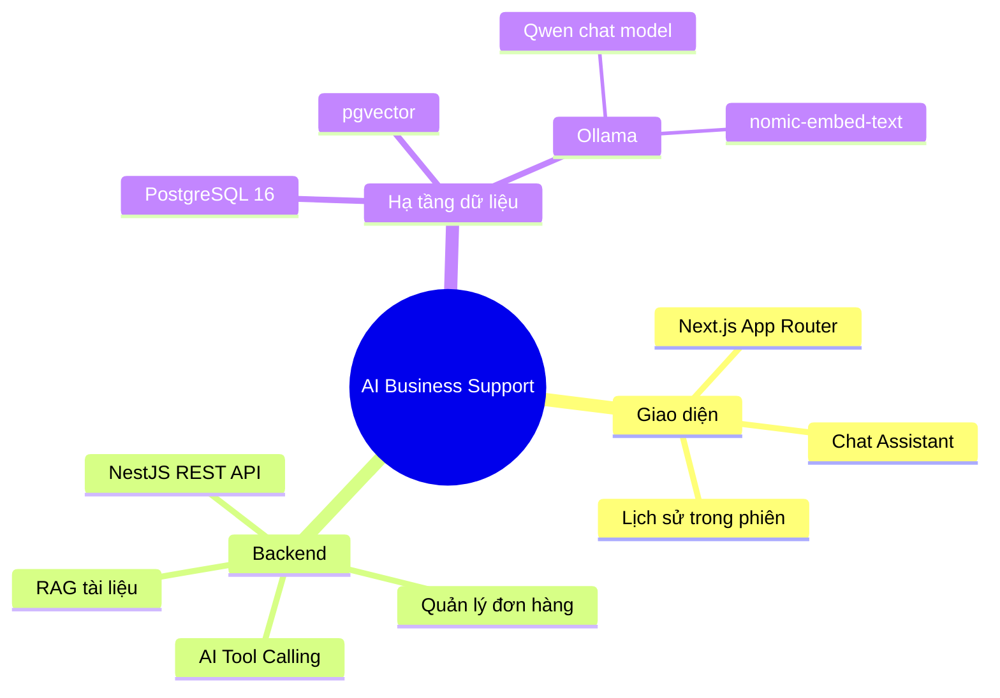
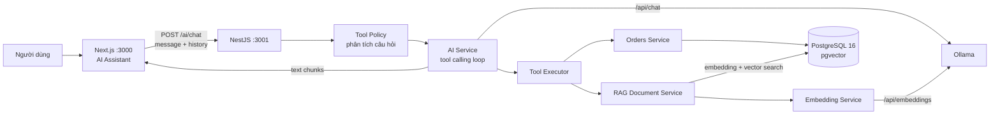
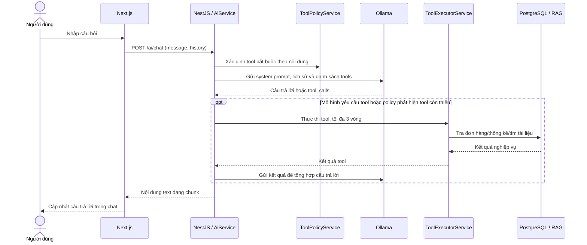
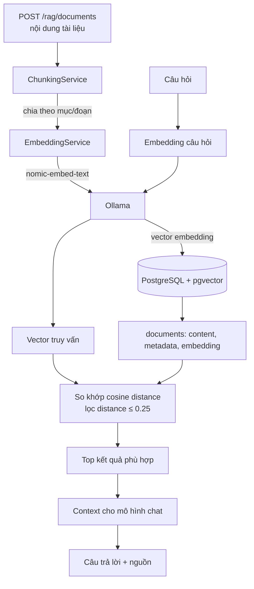

# AI Business Support

> Nền tảng hỗ trợ nghiệp vụ kinh doanh bằng AI: trò chuyện với trợ lý, tra cứu đơn hàng qua tool và tìm câu trả lời trong kho tài liệu bằng RAG.


## Mục lục

- [Tổng quan](#tổng-quan)
- [Tính năng](#tính-năng)
- [Công nghệ](#công-nghệ)
- [Kiến trúc](#kiến-trúc)
- [Luồng xử lý](#luồng-xử-lý)
- [Cấu trúc thư mục](#cấu-trúc-thư-mục)
- [Yêu cầu](#yêu-cầu)
- [Cài đặt và chạy](#cài-đặt-và-chạy)
- [Cấu hình môi trường](#cấu-hình-môi-trường)
- [API](#api)
- [Dữ liệu và RAG](#dữ-liệu-và-rag)
- [Kiểm thử và chất lượng mã](#kiểm-thử-và-chất-lượng-mã)
- [Xử lý sự cố](#xử-lý-sự-cố)
- [Phạm vi hiện tại](#phạm-vi-hiện-tại)

## Tổng quan

AI Business Support là ứng dụng web gồm giao diện chat và REST API. Backend dùng mô hình ngôn ngữ chạy qua Ollama; tùy câu hỏi, ứng dụng có thể gọi các công cụ nghiệp vụ như tra cứu đơn hàng, thống kê đơn hàng hoặc tìm kiếm tài liệu nội bộ. PostgreSQL lưu dữ liệu quan hệ và các vector embedding để hỗ trợ tìm kiếm ngữ nghĩa.



## Tính năng

- **Trợ lý chat AI:** nhận câu hỏi và lịch sử hội thoại, sau đó trả câu trả lời từ backend.
- **Tool calling cho nghiệp vụ:** bộ công cụ AI có các thao tác đọc thông tin đơn hàng, đếm đơn theo trạng thái, đếm đơn hôm nay, theo khoảng ngày và theo kỳ.
- **Tìm kiếm tri thức (RAG):** chia tài liệu thành các đoạn, tạo embedding, lưu vector và truy xuất các đoạn gần với câu hỏi.
- **Quản lý đơn hàng qua API:** tra cứu đơn theo mã; entity hiện có trạng thái `PENDING`, `CONFIRMED`, `PROCESSING`, `SHIPPING`, `COMPLETED`, `CANCELLED`.
- **Streaming phản hồi tới giao diện:** endpoint chat ghi nội dung dạng text theo từng chunk; frontend đọc response stream và cập nhật bong bóng chat.
- **Kiểm tra dữ liệu đầu vào:** NestJS bật `ValidationPipe` toàn cục với `whitelist` và `transform`.

## Công nghệ

| Lớp | Công nghệ | Vai trò |
|---|---|---|
| Frontend | Next.js 16, React 19, TypeScript | App Router, trang chat và giao diện người dùng |
| Giao diện | Tailwind CSS 4 | Utility-first styling cho màn hình trợ lý |
| Backend | NestJS 12, Node.js, TypeScript | REST API, module nghiệp vụ và điều phối AI |
| Gọi HTTP | Axios | Gọi Ollama từ backend |
| Database access | TypeORM, `pg` | Kết nối PostgreSQL, ánh xạ entity đơn hàng |
| Cơ sở dữ liệu | PostgreSQL 16 | Lưu dữ liệu ứng dụng |
| Vector search | pgvector | Lưu embedding và tính khoảng cách vector bằng toán tử `<=>` |
| AI runtime | Ollama | Phục vụ API chat và embedding tại máy chủ Ollama |
| Chat model | `AI_MODEL` trong cấu hình | Mô hình chat được chọn cho luồng tool calling |
| Embedding model | `nomic-embed-text` | Sinh vector cho câu hỏi và tài liệu |
| Kiểm thử backend | Vitest, Supertest | Unit và end-to-end tests |
| Lint/format | Oxlint, ESLint, Prettier | Kiểm tra và định dạng mã nguồn |
| Đóng gói database | Docker Compose | Khởi chạy PostgreSQL/pgvector cục bộ |

## Kiến trúc



### Backend modules

| Module | Trách nhiệm |
|---|---|
| `AiModule` | Nhận yêu cầu chat, xây dựng prompt, gọi Ollama, thực thi tool và trả lời |
| `OrdersModule` | Đọc thông tin và thống kê đơn hàng |
| `RagModule` | Tạo/chia tài liệu, embedding, tìm kiếm ngữ nghĩa và hỏi đáp theo context |
| `AppModule` | Đọc cấu hình, kết nối TypeORM/PostgreSQL và kết hợp các module |

## Luồng xử lý

### Chat và tool calling



### Nạp tài liệu và tìm kiếm RAG



Hiện tại chunking giữ nguyên các mục có độ dài tối đa 1.000 ký tự; mục dài được chia theo đoạn văn. Một đoạn đơn quá dài sẽ được cắt thành các phần 1.000 ký tự với phần chồng lấn 150 ký tự. Tìm kiếm dùng `embedding <=> query_vector`, giới hạn khoảng cách `0.25` và mặc định lấy tối đa 5 kết quả (luồng hỏi đáp RAG yêu cầu 3 kết quả).

## Cấu trúc thư mục

```text
ai-business-support/
├── README.md
├── docker-compose.yml          # PostgreSQL 16 + pgvector
├── backend/
│   ├── src/
│   │   ├── ai/                 # Chat, policy, Ollama, tools, prompts
│   │   ├── orders/             # API và entity đơn hàng
│   │   ├── rag/                # Tài liệu, chunking, embedding, tìm kiếm
│   │   ├── app.module.ts       # Config + TypeORM + feature modules
│   │   └── main.ts             # Bootstrap, CORS, ValidationPipe, port
│   ├── test/                   # E2E tests
│   ├── package.json
│   └── .env                    # Tạo cục bộ, không commit
└── frontend/
    ├── app/
    │   ├── ai-assistant/       # Giao diện chat
    │   ├── page.tsx
    │   └── globals.css
    └── package.json
```

## Yêu cầu

- Node.js tương thích với Next.js 16 (khuyến nghị Node.js 20.9 trở lên).
- npm.
- Docker Engine và Docker Compose plugin, hoặc PostgreSQL 16 có cài pgvector.
- [Ollama](https://ollama.com/) đang hoạt động và có model chat cùng model embedding.

## Cài đặt và chạy

### 1. Khởi chạy PostgreSQL

Từ thư mục gốc dự án:

```bash
docker compose up -d postgres
docker compose ps
```

Database được công bố ở `localhost:5435`, trong container là `5432`. Tên database mặc định `ai_business`, user `postgres`. Các giá trị này khớp với cấu hình Compose dành cho môi trường phát triển.

### 2. Chuẩn bị Ollama

Khởi động Ollama theo cách cài đặt của bạn, sau đó tải model chat và embedding. Ví dụ:

```bash
ollama pull qwen3:1.7b
ollama pull nomic-embed-text
```

Luồng chat dùng model lấy từ `AI_MODEL`. Các phần RAG hiện gọi trực tiếp `http://localhost:11434`; embedding dùng `nomic-embed-text`, còn endpoint `/rag/ask` đang gắn model `qwen3:1.7b` trong mã nguồn.

### 3. Cấu hình và chạy backend

```bash
cd backend
npm ci
```

Tạo `backend/.env` với các giá trị phù hợp:

```dotenv
PORT=3001

OLLAMA_BASE_URL=http://localhost:11434
AI_MODEL=qwen3:1.7b

DB_HOST=localhost
DB_PORT=5435
DB_USERNAME=postgres
DB_PASSWORD=postgres
DB_DATABASE=ai_business
```

Chạy API ở chế độ watch:

```bash
npm run start:dev
```

Backend lắng nghe tại `http://localhost:3001`. CORS hiện cho phép origin `http://localhost:3000`.

### 4. Chạy frontend

Mở terminal khác:

```bash
cd frontend
npm ci
npm run dev
```

Mở [http://localhost:3000/ai-assistant](http://localhost:3000/ai-assistant) để dùng màn hình chat. Frontend hiện gọi backend tại `http://localhost:3001`.

### Chạy ở chế độ production

```bash
# Backend
cd backend
npm run build
npm run start:prod

# Frontend (terminal khác)
cd frontend
npm run build
npm run start
```

Frontend mặc định dùng cổng 3000; backend dùng `PORT` hoặc 3001.

## Cấu hình môi trường

| Biến | Ví dụ phát triển | Ý nghĩa |
|---|---|---|
| `PORT` | `3001` | Cổng HTTP của NestJS |
| `OLLAMA_BASE_URL` | `http://localhost:11434` | Base URL Ollama cho luồng chat chính |
| `AI_MODEL` | `qwen3:1.7b` | Model chat cho `OllamaService` |
| `DB_HOST` | `localhost` | Host PostgreSQL |
| `DB_PORT` | `5435` | Cổng host được Compose ánh xạ vào PostgreSQL |
| `DB_USERNAME` | `postgres` | User PostgreSQL |
| `DB_PASSWORD` | `postgres` | Mật khẩu phát triển trong Compose; cần thay khi triển khai thật |
| `DB_DATABASE` | `ai_business` | Tên database |

> **Lưu ý:** `/rag/ask` và `EmbeddingService` hiện dùng URL Ollama/model cố định trong mã nguồn. Các luồng này không tự động lấy `OLLAMA_BASE_URL` và `AI_MODEL` từ `.env`.

## API

Base URL phát triển: `http://localhost:3001`.

| Method | Endpoint | Nội dung |
|---|---|---|
| `POST` | `/ai/chat` | Gửi `{ "message": "...", "history": [...] }`; phản hồi là text stream |
| `GET` | `/orders/:orderNumber` | Tra đơn hàng theo mã; trả `404` nếu không tìm thấy |
| `POST` | `/rag/documents` | Thêm tài liệu, tự chia chunk và tạo embedding |
| `POST` | `/rag/search` | Tìm các đoạn tài liệu gần với câu hỏi |
| `POST` | `/rag/ask` | Hỏi đáp dựa trên tài liệu truy xuất, trả answer và sources |
| `POST` | `/rag/chunk` | Xem kết quả chia đoạn từ `{ "content": "..." }` |
| `GET` | `/rag/embedding-test` | Kiểm tra embedding: số chiều và 10 phần tử đầu |

### Ví dụ chat

```bash
curl -N http://localhost:3001/ai/chat \
  -H 'Content-Type: application/json' \
  -d '{"message":"Kiểm tra trạng thái đơn hàng ORD-001","history":[]}'
```

`history` là mảng các message có `role` (`user` hoặc `assistant`) và `content`. Trường `message` bắt buộc, không rỗng và tối đa 4.000 ký tự.

### Ví dụ nạp tài liệu và tìm kiếm

```bash
curl -X POST http://localhost:3001/rag/documents \
  -H 'Content-Type: application/json' \
  -d '{"content":"1. Chính sách đổi trả\nKhách hàng có thể đổi sản phẩm trong vòng 7 ngày."}'

curl -X POST http://localhost:3001/rag/search \
  -H 'Content-Type: application/json' \
  -d '{"query":"Thời hạn đổi sản phẩm là bao lâu?"}'
```

### Ví dụ hỏi đáp RAG

```bash
curl -X POST http://localhost:3001/rag/ask \
  -H 'Content-Type: application/json' \
  -d '{"question":"Khách hàng được đổi hàng trong bao lâu?"}'
```

## Dữ liệu và RAG

### Bảng đơn hàng

TypeORM khai báo entity `orders` với các trường `id`, `order_number`, `customer_name`, `status`, `created_at`. `order_number` là duy nhất; trạng thái mặc định là `PENDING`.

### Bảng tài liệu

Service RAG dùng bảng `documents` với các cột `content`, `metadata` (JSONB), `embedding` (vector) và `created_at`/`id` trong kết quả trả về. Việc thêm tài liệu chạy embedding tuần tự cho từng chunk rồi ghi vào PostgreSQL.

Image `pgvector/pgvector:pg16` cung cấp extension pgvector, nhưng ứng dụng đang sử dụng kiểu `vector` và không có migration tạo bảng/extension đi kèm trong repository. Trước khi gọi các endpoint RAG, database cần có extension và schema tương ứng, ví dụ:

```sql
CREATE EXTENSION IF NOT EXISTS vector;

CREATE TABLE IF NOT EXISTS documents (
  id BIGSERIAL PRIMARY KEY,
  content TEXT NOT NULL,
  metadata JSONB NOT NULL DEFAULT '{}'::jsonb,
  embedding VECTOR NOT NULL,
  created_at TIMESTAMPTZ NOT NULL DEFAULT NOW()
);
```

Kích thước vector cần khớp với output của model embedding nếu bạn chọn khai báo dimension cụ thể (ví dụ `VECTOR(n)`). Hiện mã nguồn không khai báo dimension cố định trong bảng.

## Kiểm thử và chất lượng mã

Các lệnh chạy trong từng thư mục tương ứng:

```bash
# Backend
npm test             # Vitest
npm run test:watch   # Chế độ theo dõi
npm run test:cov     # Coverage
npm run test:e2e     # E2E theo vitest.config.e2e.ts
npm run lint         # Oxlint
npm run format       # Prettier cho src/ và test/

# Frontend
npm run lint         # ESLint
npm run build        # Build Next.js
```

Các test backend nằm cạnh module trong `src/**/*.spec.ts`; E2E entry point ở `backend/test/app.e2e-spec.ts`.

## Xử lý sự cố

| Hiện tượng | Cách kiểm tra |
|---|---|
| Frontend báo lỗi kết nối AI | Đảm bảo backend chạy cổng 3001 và frontend chạy `localhost:3000`; kiểm tra CORS và log backend |
| Backend không kết nối PostgreSQL | Kiểm tra container `docker compose ps`, port host `5435`, và các biến `DB_*` |
| Ollama trả lỗi model không tồn tại | Chạy `ollama list`; tải model được cấu hình trong `AI_MODEL` và model embedding `nomic-embed-text` |
| Lỗi `relation "documents" does not exist` | Tạo extension và bảng `documents` theo mục [Dữ liệu và RAG](#dữ-liệu-và-rag) |
| Lỗi `type "vector" does not exist` | Xác nhận đang dùng image pgvector và đã chạy `CREATE EXTENSION vector` trên đúng database |
| Tìm kiếm không trả kết quả | Kiểm tra dữ liệu đã nạp, model embedding nhất quán và ngưỡng khoảng cách `0.25` |

## Phạm vi hiện tại

- Compose chỉ khởi chạy PostgreSQL; Ollama cần được chạy riêng.
- Giao diện chat gọi API bằng URL localhost cố định; chưa có biến cấu hình URL backend phía frontend.
- `synchronize: true` đang bật trong TypeORM để thuận tiện phát triển. Nên dùng migrations và tắt synchronize trong môi trường production.
- README mô tả các module và endpoint tìm thấy trong mã nguồn; không giả định rằng các mục điều hướng Analytics, Orders hoặc Customers trên giao diện đã có trang chức năng.

---

<p align="center">Built for practical AI-powered business support</p>
